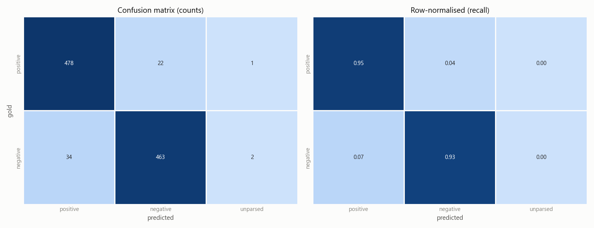
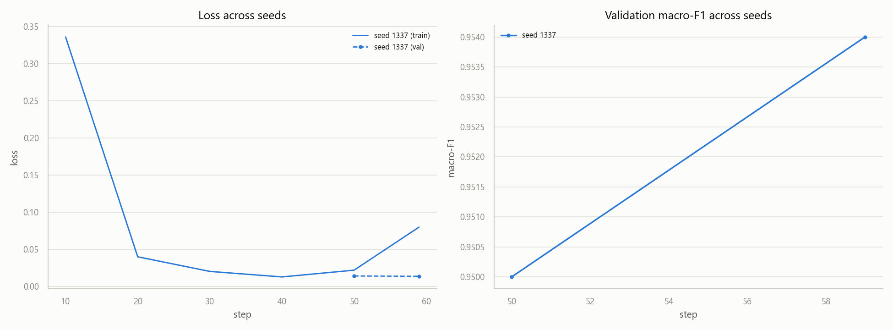
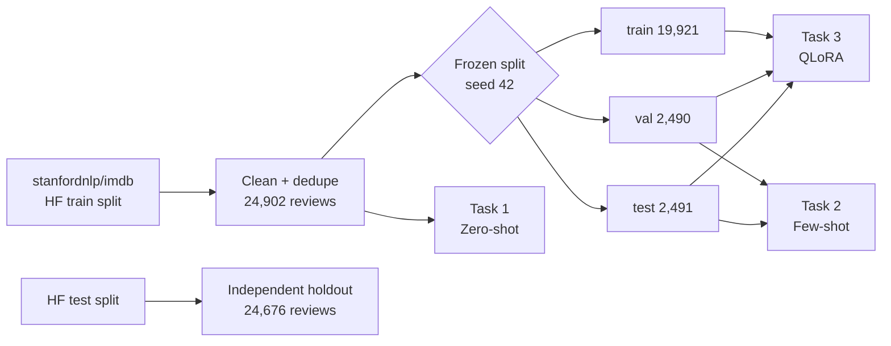
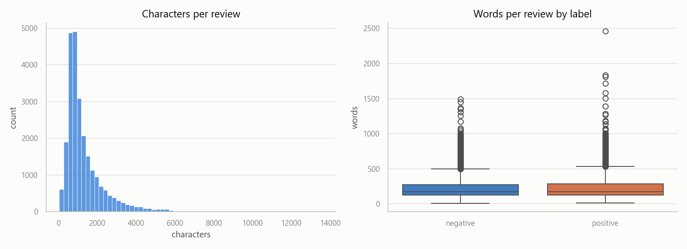

<div align="center">

# 🎬 LLM Sentiment Lab

### Zero-shot → Few-shot → QLoRA: how far can a local Llama go on IMDB sentiment?

<p>
  
  
  
  
  
  
</p>

**Binary sentiment classification of movie reviews with instruction-tuned Llama models,<br>
run end-to-end on a single consumer GPU — fully reproducible, one frozen split for every experiment.**

</div>

---

## ✨ Highlights

| | |
|---|---|
| 🧊 **One frozen split** | Created once (seed 42, 80/10/10 stratified) and shared by every task, so numbers are directly comparable. |
| 🧾 **Constrained JSON output** | The model must answer in a strict JSON schema; a parser ladder validates it and retries failures. Invalid-output rate is reported, not hidden. |
| 📏 **More than accuracy** | Macro-F1, per-class P/R/F1, confusion matrices, **calibration (ECE)**, **evidence relevance**, schema compliance, latency, tokens/s and peak VRAM. |
| 🔬 **Real ablations** | 3 zero-shot prompt styles, 10 few-shot strategies, prompt-sensitivity sweeps, self-consistency voting and multi-seed QLoRA. |
| 💻 **Runs locally** | Built for a 16 GB RTX 5080 (Blackwell, `sm_120`); every run records its exact environment. |
| ✅ **Tested offline** | Parser, prompts, metrics and training helpers are covered by tests that need no GPU and no network. |

---

## 🏆 Results at a glance

<div align="center">

| Approach | Model | Evaluated on | Macro-F1 | Invalid output |
|---|---|---|:---:|:---:|
| Zero-shot · CARP (reasoning) | Llama-3.2-3B-Instruct | 200 reviews | 0.915 | 0.0 % |
| Zero-shot · basic prompt | Llama-3.2-3B-Instruct | full pool (24,902) | 0.936 | 0.06 % |
| Zero-shot · structured prompt | Llama-3.2-3B-Instruct | full pool (24,902) | 0.940 | 0.3 % |
| Few-shot · **curated** (best of 10) | Llama-3.2-3B-Instruct | test (1,000) | 0.942 | 0.3 % |
| Few-shot · curated + self-consistency ×3 | Llama-3.2-3B-Instruct | test (1,000) | 0.944 | 0.1 % |
| 🥇 **QLoRA fine-tune** (1k samples, 1 epoch) | **Llama-3.1-8B-Instruct** | test split | **0.962** | **0.0 %** |

</div>

> **Takeaways**
> - A 3B model is already a strong zero-shot sentiment classifier (~0.94 macro-F1) — *if* the output format is constrained.
> - Few-shot gains are small on accuracy, but **example choice matters a lot for reliability**: curated demos keep schema compliance at 99.5 %, while random demos drop to ~78 % with 7 % invalid outputs.
> - Asking for reasoning (CARP) made the model **slower (≈5.5 s vs 0.3 s per review) and *less* accurate**.
> - Just **1,000 training examples and ~24 min of QLoRA** on a 16 GB GPU push the 8B model to **0.96**, with zero invalid outputs.

<table>
<tr>
<td width="50%"><p align="center"><sub>Few-shot (curated) — confusion matrix on 1,000 test reviews</sub></p></td>
<td width="50%"><p align="center"><sub>QLoRA — training/validation loss and validation macro-F1</sub></p></td>
</tr>
</table>

---

## 🧭 The three tasks



<details open>
<summary><b>Task 1 — Zero-shot</b> · Llama-3.2-3B-Instruct, no examples in the prompt</summary>

- Instruction-only system + user prompt; the model answers `{"label": "positive" | "negative"}`.
- Three prompt styles compared: **basic** (minimal), **structured zero-shot** (rules + schema) and **CARP** (clue-and-reasoning prompting).
- Scored on the whole cleaned pool (~25k reviews), with an optional independent holdout from the HF `test` split.

</details>

<details>
<summary><b>Task 2 — Few-shot</b> · 4 in-context examples, label + confidence + evidence</summary>

- The model returns a **label**, a **confidence score** and **one sentence of supporting evidence** — no chain-of-thought.
- 10 strategies: `curated`, `random`, `representative` (embedding prototypes), `contrastive` (hard pairs), `mixed` (mixed-sentiment reviews), each with and without explicit rules (`basic_*`).
- Extra quality metrics: **evidence relevance**, **calibration (ECE)** and **format compliance**.
- Follow-ups: **prompt sensitivity** (phrasing, demo order, schema renaming) for the best and worst strategy, and **self-consistency** (N samples + majority vote).

| Strategy (test, n=1,000) | Macro-F1 | Schema compliance | ECE ↓ |
|---|:---:|:---:|:---:|
| **curated** | **0.942** | **99.5 %** | 0.015 |
| basic | 0.937 | 98.5 % | 0.012 |
| basic_contrastive | 0.933 | 97.9 % | 0.037 |
| basic_representative | 0.927 | 72.7 % | 0.015 |
| basic_mixed | 0.925 | 96.4 % | 0.063 |
| representative | 0.923 | 76.9 % | 0.018 |
| contrastive | 0.913 | 95.6 % | 0.042 |
| mixed | 0.912 | 93.1 % | 0.053 |
| basic_random | 0.909 | 78.6 % | 0.054 |
| random | 0.891 | 77.6 % | 0.046 |

The curated prompt is also **robust**: across 8 prompt-sensitivity variants its macro-F1 moves by at most 0.022.

</details>

<details>
<summary><b>Task 3 — QLoRA fine-tuning</b> · Llama-3.1-8B-Instruct in 4-bit</summary>

- 4-bit NF4 base model + LoRA adapters (`r=16`, `α=32`, dropout 0.05) on all attention and MLP projections.
- Instruction-formatted data with prompt masking (loss only on the answer tokens).
- 1,000 training samples, 1 epoch, effective batch 16, lr 2e-4 → **23.5 min, 14.9 GB peak VRAM**.
- Best checkpoint chosen on validation macro-F1; multi-seed support with mean ± std reporting.

</details>

---

## 🚀 Quick start

**Requirements:** NVIDIA GPU with ≥ 8 GB (built for RTX 5080 16 GB), driver 570+, Python 3.10–3.12, ~10 GB disk.

```bash
# 1. Setup — venv + CUDA 12.8 PyTorch + creates .env from .env.example
bash setup.sh && source .venv/bin/activate                      # Linux / WSL2
# powershell -ExecutionPolicy Bypass -File setup.ps1             # Windows
# .\.venv\Scripts\Activate.ps1

# 2. Add your HuggingFace token to .env (Llama models are gated)
#    HF_TOKEN=hf_...

# 3. Sanity check — no GPU, no network, ~2 seconds
python tests/test_offline.py
```

```bash
python scripts/00_record_env.py          # record the exact environment
python scripts/01_prepare_data.py        # download, clean, freeze the split (run ONCE)
python scripts/02_run_eda.py             # exploratory data analysis

python scripts/03_run_task1.py           # Task 1 · zero-shot
python scripts/05_run_task2_fewshot.py   # Task 2 · few-shot strategy comparison
python scripts/07_run_prompt_sensitivity.py
python scripts/08_run_self_consistency.py --self-consistency 3
python scripts/12_run_task3_qlora.py     # Task 3 · QLoRA fine-tune
```

> **RTX 50-series note:** Blackwell GPUs (`sm_120`) need PyTorch ≥ 2.7 built for CUDA 12.8. A plain `pip install torch` may import fine and then crash at the first matmul — the setup scripts install the right wheel.

📖 Every flag, output file and design decision is documented in **[docs/GUIDE.md](docs/GUIDE.md)**; the architecture is described in **[REPORT.md](REPORT.md)**.

---

## 🗂️ Project structure

```
llm-sentiment/
├── configs/        # YAML configs per task / ablation (task1, task1_basic, task1_carp, task2, task3)
├── prompts/        # every prompt as a plain .txt file — easy to diff and audit
├── src/            # library code
│   ├── dataset.py          # loading, cleaning, frozen split
│   ├── model.py            # model loading (bf16 / 4-bit)
│   ├── inference.py        # batched generation, retries, latency probe
│   ├── json_parser.py      # tolerant parser ladder for constrained JSON
│   ├── metrics.py          # accuracy, macro-F1, confusion matrix, reliability
│   ├── eval_task2.py       # evidence relevance, calibration (ECE), compliance
│   ├── self_consistency.py # N-sample majority voting
│   ├── qlora.py / train_task3.py  # QLoRA fine-tuning
│   └── ...
├── scripts/        # numbered entry points, 00 → 13, run in order
├── tests/          # offline tests + mocked pipeline test
├── docs/           # full usage guide and README figures
├── REPORT.md       # architecture report
└── setup.sh / setup.ps1
```

> Data (`data/`) and run artefacts (`outputs/`) are not committed — they are fully regenerated by the scripts above.

---

## 📊 The data

[`stanfordnlp/imdb`](https://huggingface.co/datasets/stanfordnlp/imdb) — 50k English movie reviews, perfectly balanced positive/negative. After cleaning and de-duplication the pool holds **24,902** reviews (12,471 positive / 12,431 negative); reviews are long, with a median of 173 words and a heavy right tail.

<p align="center"></p>

---

## 🔁 Reproducibility

- Fixed seeds for the split, sampling and training; the split is written **once** with a manifest and never regenerated silently.
- Every run saves `run_config.json` + `env_record.json` (Python, PyTorch, CUDA, Transformers, PEFT, GPU, OS).
- Prompts live in versioned `.txt` files, not buried in code.
- Summarizer scripts (`04`, `06`, `07c`, `13`) collect every run into a single CSV for comparison.

---

<div align="center">

Made for the **Summer Course — Natural Language Processing** · by [Dikki Kartajaya](https://github.com/DikkiKartajaya)

<sub>Models: Meta Llama 3.1 / 3.2 (subject to the Llama Community License) · Dataset: Maas et al., 2011, <i>Learning Word Vectors for Sentiment Analysis</i></sub>

</div>
